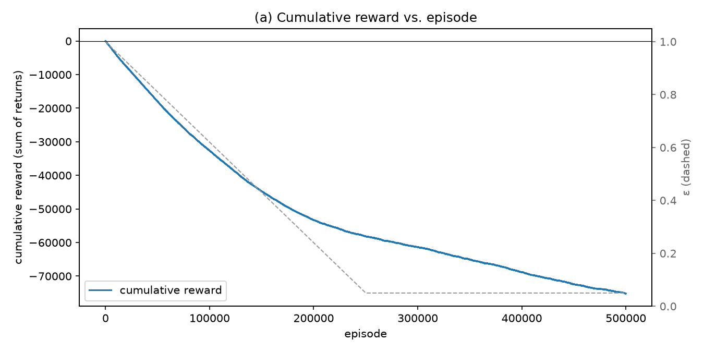
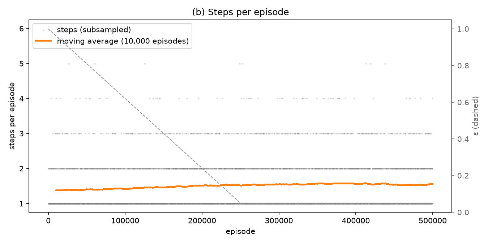
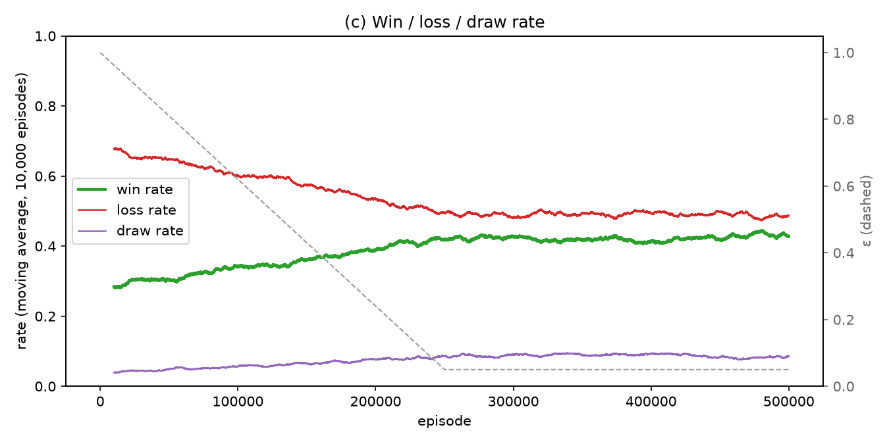
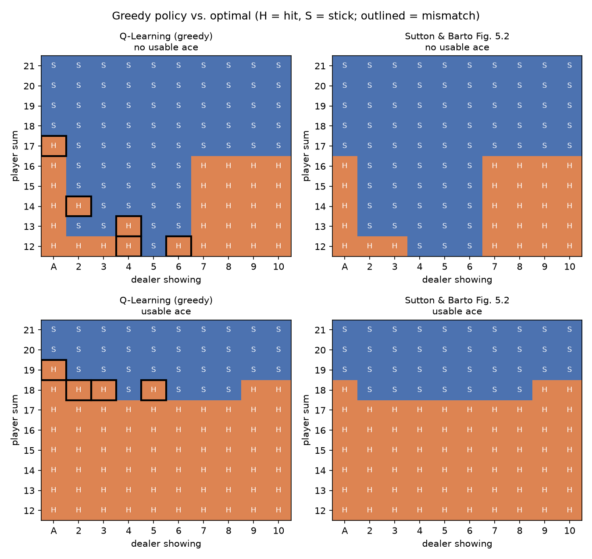

# CST_675_Week1
Understanding and Implementing Basic RL Concepts: a tabular **Q-Learning** agent trained on Gymnasium **Blackjack-v1**, then checked against the known optimal policy.

## Project Structure

| Path | Contents |
|---|---|
| `agent.py` | `QLearningAgent`: a `(32, 11, 2, 2)` NumPy Q-table, ε-greedy with linear decay, the TD update with terminal handling, and save/load. Also `format_policy()` |
| `train.py` | The training loop against `gym.make("Blackjack-v1", sab=True)`, `TrainingLog`, the learning-curve plots, and a CLI exposing α, γ, ε, and `n_episodes` |
| `evaluate.py` | Greedy (ε = 0) evaluation, a comparison with the optimal policy and three baselines, and the policy table printout |
| `plots/` | `a_cumulative_reward.png`, `b_steps_per_episode.png`, `c_win_rate.png` (from `train.py`) and `d_policy_comparison.png` (from `evaluate.py`) |
| `q_table.npy` | The trained Q-table that `train.py` writes and `evaluate.py` reads |

### Quick start

```bash
pip install -r requirements.txt
python train.py       # ~30 s: trains 500k episodes, writes q_table.npy and plots/a–c
python evaluate.py    # ~50 s: 200k greedy hands per policy, writes plots/d
```

## Setup

### Requirements

- **Python 3.10 or newer.** Gymnasium's Blackjack source uses PEP 604 union type hints such as `render_mode: str | None = None`, which fail to import on Python 3.9 and older. This project was tested on **Python 3.12.0**.
- **Gymnasium**, not legacy `gym`. See [API note](#gymnasium-api-not-legacy-gym) below.

### Install

From the repo root (Windows, Git Bash or PowerShell):

```bash
# 1. Create and activate a virtual environment
python -m venv .venv
source .venv/Scripts/activate        # Git Bash
# .venv\Scripts\Activate.ps1         # PowerShell
# source .venv/bin/activate          # macOS / Linux

# 2. Install the dependencies
pip install numpy gymnasium matplotlib
# or, equivalently:
pip install -r requirements.txt

# 3. (Optional) Only needed for render_mode="human" or "rgb_array"
pip install "gymnasium[toy-text]"
```

Step 3 installs `pygame`. Blackjack's `render()` imports `pygame`, and without it rendering raises `gymnasium.error.DependencyNotInstalled`. Training and evaluation don't render anything, so this project doesn't need it.

Versions verified in this repo's `.venv`:

| Package | Version |
|---|---|
| gymnasium | 1.4.0 |
| numpy | 2.5.4 |
| matplotlib | 3.11.2 |
| pygame | not installed (optional) |

### Smoke test

```python
import gymnasium as gym

env = gym.make("Blackjack-v1", sab=True)
obs, info = env.reset(seed=42)
print(obs, info)              # (15, 2, 0) {}
print(env.action_space)       # Discrete(2)
print(env.observation_space)  # Tuple(Discrete(32), Discrete(11), Discrete(2))
env.close()
```

Output from this repo's environment:

```
(15, 2, 0) {}
Discrete(2)
Tuple(Discrete(32), Discrete(11), Discrete(2))
```

The first observation depends on the seed and the Gymnasium version, so your tuple may be different. The action and observation spaces should match exactly. As an extra check, calling `env.step(1)` from that state returned `((25, 2, 0), -1.0, True, False, {})`: the player hit on 15, busted at 25, and the episode terminated with reward −1.

### Gymnasium API (not legacy gym)

This project uses the **Gymnasium** API (Gymnasium 0.26 and later). Legacy OpenAI `gym` (0.25 and earlier) is not compatible:

| Call | Gymnasium (used here) | Legacy `gym` |
|---|---|---|
| `env.reset(seed=...)` | returns `(obs, info)` | returns `obs`; seeding used `env.seed()` |
| `env.step(action)` | returns `(obs, reward, terminated, truncated, info)`, 5 values | returns `(obs, reward, done, info)`, 4 values |

- **`terminated`** means the episode reached a real terminal state of the MDP. In Blackjack that's a bust or a stick. When `terminated` is true, the Q-Learning target is just *R*, with no bootstrap term.
- **`truncated`** means the episode was cut off from outside the MDP, for example by a time limit. In that case the agent should still bootstrap from *S′*. Blackjack-v1 has no time limit, so `truncated` is always `False`.
- An episode ends when `terminated or truncated` is true.

### The `sab` and `natural` constructor flags

`BlackjackEnv.__init__(self, render_mode: str | None = None, natural=False, sab=False)`

| Flag | Effect |
|---|---|
| `natural` | If `True`, a natural blackjack (an ace plus a ten-valued card as the first two cards) that wins pays **+1.5** instead of +1, as in casino rules. Only applies when `sab=False`. |
| `sab` | If `True`, follows Sutton and Barto (2018, Example 5.1) exactly. **`natural` is ignored.** A player natural against a dealer non-natural is an automatic **+1** win, and both having naturals is a draw (**0**). |

Both flags default to `False` in the class constructor. However, **`Blackjack-v1` is registered with `sab=True`** (`gym.spec("Blackjack-v1").kwargs` → `{'sab': True, 'natural': False}`), so `gym.make("Blackjack-v1")` already uses the Sutton & Barto rules. This project still passes `sab=True` explicitly to make the choice clear. Because of that, results are directly comparable with the optimal policy in Sutton and Barto (2018, Fig. 5.2), and the reward is always one of {−1, 0, +1}.

## Background

### (a) What is Reinforcement Learning?

Reinforcement Learning (RL) is a type of machine learning where an **agent** learns to make decisions by interacting with an **environment**. At each step the agent sees the current **state**, picks an **action**, and gets back a **reward** and the next state. Nobody tells the agent which action is correct. It finds out by trial and error, and over time it learns a **policy** (a mapping from states to actions) that maximizes its total reward (Renze, 2020; GeeksforGeeks, 2024).

Sutton and Barto (2018) formalize this as a **Markov Decision Process (MDP)**: a set of states *S*, a set of actions *A*, transition dynamics *p(s′, r | s, a)*, and a discount factor *γ*. The goal is to find a policy that maximizes the expected return. Two ideas set RL apart from other learning problems: the **exploration–exploitation trade-off** (trying new actions vs. using what already works) and **delayed reward** (an action's consequences may only show up many steps later).

This project uses **Q-Learning**, an off-policy temporal-difference (TD) control algorithm (Sutton & Barto, 2018, §6.5). It learns an action-value function *Q(s, a)* directly from experience using this update:

```
Q(S, A) ← Q(S, A) + α [ R + γ · max_a Q(S′, a) − Q(S, A) ]
```

The agent follows an ε-greedy behavior policy while it explores. The greedy policy with respect to *Q* is what gets evaluated.

### (b) How RL differs from supervised and unsupervised learning

| | **Supervised** | **Unsupervised** | **Reinforcement** |
|---|---|---|---|
| **Training signal** | Labeled input → output pairs | No labels | Scalar reward from the environment |
| **Goal** | Predict the correct label/value | Find hidden structure (clusters, density, latent factors) | Learn a policy that maximizes cumulative reward |
| **Data** | Fixed dataset, assumed i.i.d. | Fixed dataset | Generated by the agent's own actions, sequential and correlated |
| **Feedback** | Immediate and instructive ("the answer was *y*") | None | Evaluative and often delayed ("that was worth *r*") |
| **Typical tasks** | Classification, regression | Clustering, dimensionality reduction | Control, games, robotics, sequential decision-making |

(Simplilearn, 2020; GeeksforGeeks, 2024)

The key difference is the kind of feedback. Supervised learning gets *instructive* feedback: it is told the correct answer. RL gets *evaluative* feedback: it is told how good its chosen action was, but not whether a different action would have been better (Sutton & Barto, 2018, Ch. 1–2). The agent's actions also decide what data it sees next, so RL has to manage exploration itself. Neither supervised nor unsupervised learning has to deal with that. And RL is not unsupervised learning either, because it is optimizing a reward signal rather than just looking for structure in data (Sutton & Barto, 2018, §1.1).

### (c) Why Blackjack is a tractable MDP for a first tabular implementation

Sutton and Barto (2018, Example 5.1) use Blackjack as a standard teaching example, and Gymnasium's `Blackjack-v1` follows their formulation. It works well for a first tabular agent for these reasons:

- **Small, discrete state space.** A state is the tuple *(player sum, dealer's showing card, usable ace)*. Only about 200 states actually involve a decision (player sum 12–21 × dealer card 1–10 × usable ace yes/no), and Gymnasium's whole observation space is just 32 × 11 × 2 = 704. A NumPy array or dictionary can hold the full Q-table, so no function approximation is needed.
- **Two actions.** The agent can only *stick* (0) or *hit* (1), so the table stays small and the learned policy is easy to read.
- **It satisfies the Markov property.** Cards are drawn from an infinite deck (with replacement), so the current state contains everything needed to predict what happens next. There is no hidden card-counting history.
- **Short episodes.** A hand ends after a few steps, so the agent can play hundreds of thousands of episodes in seconds and Q-values converge quickly.
- **Simple, terminal-only rewards.** The reward is +1 for a win, −1 for a loss, and 0 for a draw, and it only comes at the end of the hand. With no discounting (*γ* = 1), the value of a state is just the expected outcome of the hand. This still gives a real credit-assignment problem without being too hard.
- **Stochastic but model-free friendly.** Card draws are random, so the agent has to learn from sampled experience rather than from known dynamics, which is the situation Q-Learning is designed for.
- **There is a known answer to check against.** Sutton and Barto (2018, Fig. 5.2) show the optimal policy. That lets us check whether the agent learned a *competent* policy, not just whether its reward curve went up.

## RL System Components and the Blackjack MDP

### Sub-elements of an RL system

| Element | What it is | In Blackjack-v1 |
|---|---|---|
| **Agent** | The learner and decision-maker. It picks actions and updates what it knows from the results. | The Q-Learning player |
| **Environment** | Everything outside the agent. It takes an action and returns the next state and a reward. | The `Blackjack-v1` simulator: the deck, the dealer's fixed strategy, and the scoring rules |
| **State** (*s*) | The information the agent observes before it decides what to do. | `(player_sum, dealer_card, usable_ace)` |
| **Action** (*a*) | A choice the agent can make in a state. | `0 = stick`, `1 = hit` |
| **Reward** (*r*) | A number the environment sends back after each step. It defines the goal: the agent tries to maximize the total reward it collects, not the reward from any single step. | +1 win, −1 loss, 0 draw (or 0 while the hand is still going) |
| **Policy** (*π*) | The agent's behavior: a rule that maps states to actions. It can be deterministic, *a = μ(s)*, or stochastic, *a ~ π(·∣s)*. | "Hit on 16 or less unless the dealer shows 2–6," or the greedy policy from the learned Q-table |

(OpenAI, n.d.; TpointTech, n.d.)

Shaier (2020), following Sutton and Barto (2018, §1.3), names four main sub-elements: **policy**, **reward signal**, **value function**, and an optional **model** of the environment. The first two are in the table. The other two are:

- **Value function.** The reward tells the agent what is good *right now*. A value function estimates what is good *in the long run*, meaning the expected return from a state, *V(s)*, or from a state–action pair, *Q(s, a)*. The Q-table in this project is a value function. The policy is read from it by picking *argmaxₐ Q(s, a)*.
- **Model.** A model predicts the next state and reward the environment will produce. Q-Learning is **model-free**: it never learns or uses the transition probabilities. It learns *Q* directly from sampled experience.

### The agent–environment interaction loop

```
            ┌──────────────────────────────┐
            │            AGENT             │
            │  policy π(a|s), Q-table      │
            └──────────────────────────────┘
               ▲  state Sₜ₊₁          │ action Aₜ
               │  reward Rₜ₊₁         ▼
            ┌──────────────────────────────┐
            │         ENVIRONMENT          │
            │   Blackjack-v1 (deck, dealer)│
            └──────────────────────────────┘
```

1. The environment starts an episode and gives the agent an initial state *S₀*. In Gymnasium this is `env.reset()`.
2. At each time step *t*, the agent observes *Sₜ* and picks an action *Aₜ* using its policy.
3. The environment carries out the action and returns a reward *Rₜ₊₁* and the next state *Sₜ₊₁*. In Gymnasium this is `env.step(action)`, which also returns `terminated`, `truncated`, and `info`.
4. The agent uses the transition *(Sₜ, Aₜ, Rₜ₊₁, Sₜ₊₁)* to update its estimates. For Q-Learning this is one TD update of *Q(Sₜ, Aₜ)*.
5. Steps 2–4 repeat until the episode reaches a terminal state. Then a new episode begins.

The sequence *τ = (S₀, A₀, R₁, S₁, A₁, R₂, …)* is called a **trajectory** or **rollout**. Over a trajectory, the agent's objective is the **return**, which is the sum of rewards, possibly discounted (OpenAI, n.d.).

### Formal definition: Blackjack-v1 as a Markov Decision Process

An MDP is a tuple **⟨S, A, P, R, γ⟩**, together with an initial-state distribution *ρ₀* (Dhakal, 2023; OpenAI, n.d.; Sutton & Barto, 2018, Ch. 3). What makes it an MDP is the **Markov property**: the next state and reward depend only on the current state and action, not on anything that happened earlier.

*P(Sₜ₊₁, Rₜ₊₁ ∣ Sₜ, Aₜ) = P(Sₜ₊₁, Rₜ₊₁ ∣ S₀, A₀, …, Sₜ, Aₜ)*

This project uses `gym.make("Blackjack-v1", sab=True)`. With this setting the environment follows the rules in Sutton and Barto (2018, Example 5.1) exactly.

#### States — *S*

*s = (player_sum, dealer_card, usable_ace)*, with observation space `Tuple(Discrete(32), Discrete(11), Discrete(2))`:

| Component | Space | Values that actually occur | Meaning |
|---|---|---|---|
| `player_sum` | `Discrete(32)` → 0–31 | 4–21 when a decision is made; up to 31 after a bust | Current total of the player's hand. An ace counts as 11 if that doesn't take the total over 21. |
| `dealer_card` | `Discrete(11)` → 0–10 | 1–10 (1 = ace; 0 is never used) | The dealer's single face-up card |
| `usable_ace` | `Discrete(2)` → 0/1 | 0 or 1 | 1 if the player holds an ace that is currently counted as 11 |

That gives 32 × 11 × 2 = **704** possible observations. Only about **200** of them involve a real choice: `player_sum` 12–21 × `dealer_card` 1–10 × `usable_ace` 0/1. Below 12, a hit can never bust you, so hitting is always right. This is the reduced state space Sutton and Barto analyze.

#### Actions — *A*

`Discrete(2)`: **0 = stick** (stop taking cards and end your turn) and **1 = hit** (take another card). Both actions are available in every state.

#### Rewards — *R*

With `sab=True`:

| Outcome | Reward |
|---|---|
| Player wins (dealer busts, or player's final total is closer to 21) | **+1** |
| Player loses (player busts, or dealer's final total is closer to 21) | **−1** |
| Draw (equal totals) | **0** |
| Any step that doesn't end the hand (a hit without busting) | **0** |

The `natural` flag (a 1.5× payout for a natural blackjack) is **ignored** when `sab=True`. A natural (an ace plus a ten-valued card as the first two cards) that the dealer doesn't match just counts as an ordinary win (+1), as in Sutton and Barto. Because reward only arrives when the hand ends, the agent has to work out which earlier hit or stick decisions led to the result. That is the credit-assignment problem.

#### Transitions and termination — *P*

- **Initial state (*ρ₀*):** The player and the dealer each get two cards. One dealer card is face up, and that card is `dealer_card`.
- **Card distribution:** Cards come from an **infinite deck**, sampled with replacement. Values 1 (ace) through 9 each have probability 1/13. A ten-valued card (10, J, Q, K) has probability 4/13. Since previous draws don't change the odds, the state tuple is enough to predict what happens next, so the Markov property holds.
- **Hit (1):** The player draws one card. If the new total is over 21, the player **busts** and the episode **terminates** with reward −1. Otherwise the episode goes on with reward 0 and an updated state.
- **Stick (0):** The episode **terminates**. The dealer reveals the hidden card and **draws until their total is ≥ 17** (the dealer also stands on a soft 17). The dealer's total is then compared with the player's to give +1, −1, or 0.
- Blackjack-v1 has no time limit, so `truncated` is always `False`. Every episode ends by termination, usually after just a few steps.

The environment stores these dynamics internally but never shows them to the agent. A model-free Q-Learning agent has to learn from sampled transitions alone.

#### Discount factor — *γ*

The return from time *t* is

*Gₜ = Rₜ₊₁ + γRₜ₊₂ + γ²Rₜ₊₃ + … = Σₖ γᵏ Rₜ₊ₖ₊₁*, with *0 ≤ γ ≤ 1*.

The discount factor sets how much future rewards count compared with immediate ones (Sutton & Barto, 2018, §3.3; OpenAI, n.d.):

- **γ close to 0** makes the agent short-sighted. It mostly cares about the next reward.
- **γ close to 1** makes the agent far-sighted. Future rewards count almost as much as immediate ones.
- In continuing tasks with no natural end, **γ < 1** is needed mathematically so the infinite sum stays finite.

`Blackjack-v1` has no γ of its own. It is a hyperparameter of the agent, used in the target *R + γ · maxₐ Q(S′, a)*. Blackjack is **episodic** and every episode ends after a few steps, so the return stays finite even with **γ = 1**, which is what Sutton and Barto use. With γ = 1, *Q(s, a)* is exactly the expected outcome of the hand (between −1 and +1), and the learned policy maximizes expected winnings. A γ below 1 would shrink the value of later rewards and make the agent slightly prefer shorter hands (sticking early). That changes the objective without any benefit here. This project therefore uses **γ = 1.0** by default.

## Inside `BlackjackEnv.step`: Reward and Transition Logic

All line numbers below refer to `gymnasium/envs/toy_text/blackjack.py` in **Gymnasium 1.4.0**, the version installed in `.venv` (Farama Foundation, n.d.). Each behavior described here was checked by running the environment with fixed hands (see [Verification](#verification-of-edge-cases)).

### The source, annotated

```python
# Lines 74–75: three-way comparison → +1.0, -1.0, or 0.0
def cmp(a, b):
    return float(a > b) - float(a < b)

# Line 79: one rank per entry; J/Q/K all count as 10
deck = [1, 2, 3, 4, 5, 6, 7, 8, 9, 10, 10, 10, 10]

def draw_card(np_random):                 # line 82: sample WITH replacement
    return int(np_random.choice(deck))

def usable_ace(hand):                     # line 90: ace counts as 11 if that doesn't bust
    return int(1 in hand and sum(hand) + 10 <= 21)
def sum_hand(hand):                       # line 94
    if usable_ace(hand):
        return sum(hand) + 10
    return sum(hand)
def is_bust(hand):  return sum_hand(hand) > 21               # line 100
def score(hand):    return 0 if is_bust(hand) else sum_hand(hand)  # line 104: bust scores 0
def is_natural(hand): return sorted(hand) == [1, 10]         # line 108: exactly A + ten-card

def step(self, action):                                       # line 242
    if action:  # hit                                         # line 244
        self.player.append(draw_card(self.np_random))
        if is_bust(self.player):
            terminated = True;  reward = -1.0                 # line 247
        else:
            terminated = False; reward = 0.0
    else:       # stick
        terminated = True                                     # line 253
        while sum_hand(self.dealer) < 17:                     # line 254
            self.dealer.append(draw_card(self.np_random))
        reward = cmp(score(self.player), score(self.dealer))  # line 256
        if self.sab and is_natural(self.player) and not is_natural(self.dealer):
            reward = 1.0                                      # line 257: S&B override
        elif not self.sab and self.natural and is_natural(self.player) and reward == 1.0:
            reward = 1.5                                      # line 267: casino payout
    return self._get_obs(), reward, terminated, False, {}     # line 272
```

The listing is shortened, but the logic matches the source exactly.

### The +1 / −1 / 0 reward scheme

Rewards come from exactly two places:

1. **Hit (line 244).** A bust gives **−1.0**. Otherwise the reward is **0.0** and the hand goes on. A hit can never give a positive reward.
2. **Stick (line 256).** `cmp(score(player), score(dealer))` returns **+1.0**, **−1.0**, or **0.0**. `score()` gives a busted hand 0 points, so a dealer bust is automatically a player win, because any player who reached the stick step has not busted. The player's own bust never gets this far, because it already ended the episode in branch 1.

So with `sab=True` the reward is always one of {−1, 0, +1}, and it is non-zero only on the final step of an episode. This matches Sutton and Barto's (2018) reward hypothesis (§3.2): the reward should say *what* the agent should achieve (win the hand), not *how* to do it. The environment gives no shaping rewards for subgoals such as "get close to 21." As Sutton and Barto warn in their chess example, rewarding subgoals can lead the agent to chase the subgoal instead of the real goal.

### The `sab` natural-blackjack override

The basic comparison at line 256 can't distinguish a natural blackjack from any other 21. Line 257 adds the Sutton and Barto (2018, Example 5.1) rule:

| Player hand | Dealer hand | `cmp` result | Final reward with `sab=True` | Why |
|---|---|---|---|---|
| Natural (A + 10) | Not a natural, any total | might be 0 (dealer reaches 21) or +1 | **+1** | Override: a natural beats anything except a natural |
| Natural | Natural | 0 | **0** | Override doesn't apply. It's a draw |
| 3+ card 21 | Natural | 0 | **0** | No dealer-natural override exists, so `cmp` gives a draw |

The `natural` flag is checked in the `elif` branch, and that branch only runs when `not self.sab`. So with `sab=True` the 1.5 payout can never happen, which is how `natural` gets ignored.

**One thing to know about the implementation:** The environment doesn't end the episode automatically on a natural. A player holding A + 10 still gets a normal `(21, dealer_card, 1)` observation and has to choose to stick to collect the +1. If they hit instead, the hand has more than two cards and stops counting as a natural, so the agent has to learn to stick on 21.

### How `terminated` is set: bust vs. stick

| Event | Line | `terminated` | `reward` | Observation returned |
|---|---|---|---|---|
| Hit, no bust | 244–250 | `False` | 0.0 | New `player_sum`, possibly a changed `usable_ace` |
| Hit, bust | 247 | `True` | −1.0 | `player_sum` > 21 (at most 31) |
| Stick | 253 | `True` | ±1.0 / 0.0 | **The same as the state before sticking** |

- On a **bust**, the episode ends immediately. **The dealer never plays**, so the player loses even if the dealer would have busted too. Because the player always acts first, this is where the house edge comes from.
- On a **stick**, `terminated` is set to `True` *before* the dealer draws. The whole dealer turn happens inside this one `step()` call, so from the agent's point of view it is part of the environment's transition dynamics. The agent never sees the dealer's hidden card or any of their draws.
- `truncated` is always `False` (line 272). The source comment refers to a `TimeLimit` wrapper, but `gym.spec("Blackjack-v1").max_episode_steps` is `None`, so no wrapper is ever added.

**Why this matters for Q-Learning:** After a stick, the next observation *S′* is the **same tuple** as the state the agent just left. If the update bootstrapped on it, *R + γ · maxₐ Q(S′, a)* would feed the state's own value back into its target, which is wrong. Sutton and Barto (2018, §3.4) treat the end of an episode as an absorbing state with value 0, so when `terminated` is true the target must be just *R*.

### The dealer's draw-to-≥17 policy

`while sum_hand(self.dealer) < 17` (line 254) is a **fixed, deterministic policy** for the dealer:

- The dealer hits on 16 or less and stands on **17 or more**.
- `sum_hand()` counts a usable ace as 11, so the dealer **stands on a soft 17**. For example, A + 6 counts as 17, so the dealer stops (confirmed in Hand 6 below).
- The dealer never reacts to the player's total. So from the agent's point of view, the dealer is just part of the environment's stochastic transition function. It isn't a second agent the player is competing against, which is why the problem is a single-agent MDP rather than a game between two players (Sutton & Barto, 2018, Example 5.1).

### The infinite-deck assumption

`draw_card()` (line 82) calls `np_random.choice(deck)` on a fixed 13-entry list and never removes a card. That means:

- *P(card = 1..9) = 1/13* each, and *P(card = 10) = 4/13*, the same on every draw.
- Past draws give no information about future ones, so **card counting is impossible**. The observation `(player_sum, dealer_card, usable_ace)` is a **sufficient statistic** for what happens next. That is why the Markov property holds, which Sutton and Barto (2018, §3.1) require for the next state to depend only on the current state and action.
- With a finite deck, the cards already dealt would affect the next draw, so the observation would no longer describe the state fully. The problem would then be partially observable, which tabular Q-Learning over this state tuple can't represent.

### Worked example 1: the player hits and busts

Fixed deal: player `[10, 6]`, dealer `[9, 7]`. The next card drawn is a 10.

| Step | Detail |
|---|---|
| Start | `_get_obs()` → `player_sum = 16`, `dealer_card = 9`, `usable_ace = 0` → **S = (16, 9, 0)** |
| Action | **1 (hit)**, so line 244 takes the hit branch |
| Draw | The player draws a 10 and the hand becomes `[10, 6, 10]`. There's no ace, so `sum_hand` = 26 |
| Check | `is_bust`: 26 > 21 → `True` → line 247 sets `terminated = True` and `reward = -1.0` |
| Dealer | Doesn't play. The dealer's hand stays `[9, 7]` |
| Return | `((26, 9, 0), -1.0, True, False, {})` |
| Q-Learning target | `terminated` is true, so the target = *R* = **−1**, and *Q((16, 9, 0), hit)* moves toward −1 |

### Worked example 2: the player sticks on 18 and the dealer draws to 20

Fixed deal: player `[10, 8]`, dealer `[6, 4]` (the 6 is face up). The dealer's next card is a 10.

| Step | Detail |
|---|---|
| Start | **S = (18, 6, 0)** |
| Action | **0 (stick)**, so line 253 sets `terminated = True` |
| Dealer loop (line 254) | `sum_hand([6, 4])` = 10 < 17 → draws a 10 → `[6, 4, 10]` = 20 ≥ 17 → stops |
| Score | `score(player)` = 18, `score(dealer)` = 20 (neither busted) |
| Reward (line 256) | `cmp(18, 20)` = `float(False) − float(True)` = **−1.0** |
| Override (line 257) | `is_natural([10, 8])` is `False`, so no change |
| Return | `((18, 6, 0), -1.0, True, False, {})`. The observation is the **same** as *S* |
| Q-Learning target | target = *R* = **−1** (no bootstrap) |

This one result doesn't mean sticking on 18 against a 6 was a bad decision. A dealer showing 6 busts often, and in Sutton and Barto's (2018, Fig. 5.2) optimal policy, sticking on 18 is correct against every dealer card. Q-Learning averages over many outcomes like this one, so *Q((18, 6, 0), stick)* converges to the *expected* reward. That expected value is positive even though this particular hand lost.

### Verification of edge cases

I set the player's and dealer's hands directly on `env.unwrapped` and replaced `np_random` with a fixed card sequence, then ran `step()` in Gymnasium 1.4.0 with `sab=True`:

| # | Player | Dealer | Action → draw | Returned `(obs, reward, terminated, truncated)` |
|---|---|---|---|---|
| 1 | `[10, 6]` | `[9, 7]` | hit → 10 | `((26, 9, 0), -1.0, True, False)` |
| 2 | `[10, 8]` | `[6, 4]` | stick → dealer draws 10 | `((18, 6, 0), -1.0, True, False)` |
| 3 | `[1, 6]` (soft 17) | `[10, 7]` | hit → 10 | `((17, 10, 0), 0.0, False, False)`: the ace switches to counting as 1 |
| 4 | `[1, 10]` natural | `[5, 6]` | stick → dealer draws 10 (21) | `((21, 5, 1), 1.0, True, False)`: override turns a draw into +1 |
| 5 | `[1, 10]` natural | `[10, 1]` natural | stick | `((21, 10, 1), 0.0, True, False)`: draw |
| 6 | `[10, 8]` | `[1, 6]` soft 17 | stick → dealer stands | `((18, 1, 0), 1.0, True, False)` |
| 7 | `[5, 6, 10]` (21) | `[1, 10]` natural | stick | `((21, 1, 0), 0.0, True, False)`: draw |
| 8 | `[10, 10]` | `[6, 10]` | stick → dealer draws 10 (26) | `((20, 6, 0), 1.0, True, False)`: dealer bust, score 0 |

## Tabular Q-Learning Agent (`agent.py`)

### Usage

```bash
python train.py                                       # defaults below
python train.py --n-episodes 1000000 --alpha 0.005 --gamma 1.0 \
    --epsilon-start 1.0 --epsilon-final 0.05 --epsilon-decay-fraction 0.5 \
    --seed 0 --save q_table.npy
```

| Hyperparameter | CLI flag | Default | Role |
|---|---|---|---|
| **α** (learning rate) | `--alpha` | `0.01` | How far each update moves *Q(s, a)* toward the TD target. Blackjack outcomes are very noisy (±1), so a small α averages over many hands. |
| **γ** (discount) | `--gamma` | `1.0` | How much future rewards are worth. Episodes are short and always end, so the return is the hand's outcome without any discounting (see [Discount factor](#discount-factor--γ)). |
| **ε** (exploration) | `--epsilon-start`, `--epsilon-final`, `--epsilon-decay-fraction` | `1.0 → 0.05` over the first 50% of episodes | Probability of taking a random action. It decays linearly per episode and then stays at the final value. |
| **n_episodes** | `--n-episodes` | `500000` | Number of hands to train on. |

The same parameters are arguments to `train(...)` and `QLearningAgent(...)` if you import the module.

### Design choice: dense `(32, 11, 2, 2)` array instead of a dict

The Q-table is `np.zeros((32, 11, 2, 2))`, indexed as `q[player_sum, dealer_card, usable_ace, action]`.

Only `player_sum` 4–21 and `dealer_card` 1–10 ever come up in a decision. Indices 0–3 and 22–31 of `player_sum`, plus index 0 of `dealer_card`, are never used. A dict keyed by observation would store only states the agent actually visits. The array is still the better choice here:

- **Size is not a concern.** 32 × 11 × 2 × 2 = 1,408 float64 values, or **11 KB**. Of those, 18 × 10 × 2 = 360 states (720 values) are reachable decision states. Unused cells waste about 5 KB.
- **The indices are the observation itself.** Gymnasium's spaces start at 0, so `q[obs]` works directly with the observation tuple from `env.step()`. There's no hashing, no `defaultdict`, and no offset like `player_sum - 4` that could introduce off-by-one bugs.
- **Bust states are covered automatically.** After a bust, `next_obs` has `player_sum` 22–31. Those cells exist in the array, and because `terminated` is true they are never used to bootstrap. They stay at 0, which is the correct value for a terminal state.
- **Analysis is vectorized.** `np.argmax(q, axis=-1)` gives the whole greedy policy in one call, and slicing such as `q[12:22, 1:11, usable_ace]` gives the 10 × 10 grids Sutton and Barto plot in Fig. 5.2. With a dict, each of these would need a loop.
- **The dict would mainly help with large or unknown state spaces**, where allocating everything up front isn't practical. Blackjack's space is small and known exactly from `observation_space`.

### ε-greedy with decay

`act(obs)` picks a random action with probability ε. Otherwise it picks *argmaxₐ Q(obs, a)* and **breaks ties at random**. Breaking ties at random matters here: the table starts at 0, and `np.argmax` always returns the first index of a tie, which is action 0 (stick). Without random tie-breaking, the greedy choice in every new state would be stick.

ε starts at 1.0, which is pure exploration, and drops linearly by `(ε_start − ε_final) / (n_episodes × decay_fraction)` after each episode until it reaches `ε_final`. Exploring heavily early means every (state, action) pair gets tried. Exploration then shrinks, but it never goes to zero, so Q-values keep getting refined. This follows the GLIE idea (greedy in the limit with infinite exploration) used to motivate ε-greedy control (Sutton & Barto, 2018, §5.4, §6.5).

### The update and terminal-state handling

```python
future     = 0.0 if terminated else gamma * max(Q[s'])
td_target  = r + future
td_error   = td_target - Q[s][a]
Q[s][a]   += alpha * td_error
```

This is the Q-Learning update from Sutton and Barto (2018, §6.5): *Q(S, A) ← Q(S, A) + α [R + γ · maxₐ Q(S′, a) − Q(S, A)]*. A terminal state has value 0 by definition (§3.4), so when `terminated` is true the *maxₐ Q(S′, a)* term is dropped. In Blackjack, every episode ends with either a stick or a bust, so every episode includes at least one terminal update.

- **Bust:** *S′* has `player_sum` > 21. Those cells are always 0, so bootstrapping wouldn't change the answer, but the code still explicitly doesn't bootstrap.
- **Stick:** `env.step()` returns **the same tuple** as *S* (see [above](#how-terminated-is-set-bust-vs-stick)). Bootstrapping would feed *maxₐ Q(S, a)*, the state's own value, back into its target. That bug is easy to miss and it biases learning. The `terminated` check prevents it.
- Only `terminated` turns off bootstrapping, not `truncated`. A truncated step should still bootstrap from *S′*. Blackjack never truncates, but the agent handles that case correctly anyway.

This is the standard structure in the Q-Learning tutorials referenced here (GeeksforGeeks, n.d.; DataCamp, n.d.): a table of state–action values, ε-greedy action selection, and a TD update toward *r + γ · max Q(s′, ·)*.

### Hand-computed updates at state (15, 10, 0)

State *(15, 10, 0)*: the player has a hard 15 and the dealer shows a 10. Settings are **α = 0.01** and **γ = 1.0**. The starting Q-values below are example mid-training values. As in Huddar's (2022) worked example, each update is computed step by step.

**Update 1: hit, no bust (non-terminal, bootstraps)**

The agent hits and draws a 3, so *S′ = (18, 10, 0)*, *R = 0*, and `terminated = False`.

| Quantity | Value |
|---|---|
| *Q((15, 10, 0), hit)* | −0.40 |
| *Q((18, 10, 0), stick)*, *Q((18, 10, 0), hit)* | −0.20, −0.60 |
| *maxₐ Q(S′, a)* | −0.20 (stick) |
| TD target = *R + γ · max* | 0 + 1.0 × (−0.20) = **−0.20** |
| TD error *δ* = target − *Q(S, A)* | −0.20 − (−0.40) = **+0.20** |
| New *Q((15, 10, 0), hit)* = *Q + αδ* | −0.40 + 0.01 × 0.20 = **−0.398** |

Hitting got slightly better because it led to a state (18 vs. 10) whose best action is worth more than the current estimate for hitting on 15.

**Update 2: stick and lose (terminal, no bootstrap)**

The agent sticks and the dealer reaches 20, so *R = −1* and `terminated = True`. *S′* is again *(15, 10, 0)*.

| Quantity | Value |
|---|---|
| *Q((15, 10, 0), stick)* | −0.50 |
| TD target = *R* (terminal) | **−1.0** |
| TD error *δ* | −1.0 − (−0.50) = **−0.50** |
| New *Q((15, 10, 0), stick)* | −0.50 + 0.01 × (−0.50) = **−0.505** |

*If the code had bootstrapped by mistake*, the target would have been −1.0 + max(−0.50, −0.40) = **−1.40**. That's outside the range of possible returns, [−1, +1], and it would push every value for sticking too low.

**Update 3: hit and bust (terminal)**

The agent draws a 10, so *S′ = (25, 10, 0)* and *R = −1*. Starting from *Q((15, 10, 0), hit)* = −0.40, the TD error is −1.0 − (−0.40) = −0.60, and the new value is −0.40 + 0.01 × (−0.60) = **−0.406**.

All three results match what `QLearningAgent.update()` returns: δ = 0.2, −0.5, −0.6 and new Q = −0.398, −0.505, −0.406.

### First training run

`python train.py` (500,000 episodes, defaults, seed 0, about 29 s):

```
first 10,000: mean reward -0.3929  ...
last  10,000: mean reward -0.0587  ...
Q[(15, 10, 0)] = stick -0.5914, hit -0.4684
```

- The average reward per hand improves from −0.39 while the agent is mostly exploring to −0.06 once ε = 0.05. Even an optimal player loses money at this game, so the agent can't do better than a small negative average.
- At *(15, 10, 0)* the agent prefers **hit** (−0.47 vs. −0.59 for stick). That matches Sutton and Barto's (2018, Fig. 5.2) optimal policy, which hits a hard 15 against a dealer 10.

These numbers come from training with exploration still on. See [Greedy Evaluation and Baselines](#greedy-evaluation-and-baselines-evaluatepy) for the ε = 0 results.

## Training Loop, Logging, and Plots

### Usage

```bash
python train.py                     # train + print stats + save q_table.npy and plots/a–c
python train.py --window 5000 --plot-dir plots
```

The plotting code is `plot_training(log, out_dir, window)` in `train.py`.

### The loop (in `train()` in `train.py`)

```python
obs, info = env.reset(seed=seed if episode == 0 else None)
total_reward, steps = 0.0, 0
while True:
    action = agent.act(obs)
    next_obs, reward, terminated, truncated, info = env.step(action)   # Gymnasium 5-tuple
    agent.update(obs, action, reward, next_obs, terminated)            # NOT (terminated or truncated)
    obs = next_obs
    total_reward += reward
    steps += 1
    if terminated or truncated:
        break
log.record(total_reward, steps, agent.epsilon, terminated)
agent.decay_epsilon()
```

Only the first `reset()` gets the seed. Every later reset continues the same RNG stream, so a whole run can be repeated exactly: re-running with `--seed 0` produces identical numbers.

### `terminated` vs. `truncated`: which one goes into the update

| | `terminated` | `truncated` |
|---|---|---|
| **Meaning** | The MDP reached a real terminal state | The episode was stopped from outside the MDP (time limit, step cap) |
| **Value of *S′*** | 0 by definition (Sutton & Barto, 2018, §3.4) | Unknown. *S′* is a normal state that has a future |
| **Q-Learning target** | *R* | *R + γ · maxₐ Q(S′, a)* |
| **Ends the loop?** | Yes | Yes |
| **In Blackjack-v1** | Every episode (stick or bust) | Never (`max_episode_steps=None`) |

The two flags play different roles. `terminated or truncated` decides **when to stop the loop**. `terminated` alone decides **whether to bootstrap**. If you passed `done = terminated or truncated` into the update, a time-limited episode would be treated as if its final state were worth 0. That bias goes unnoticed in Blackjack because truncation never happens. But it's a real bug in environments that do truncate, such as CartPole's 500-step cap. In this run the log confirms `terminated: 500,000  truncated: 0`.

### What gets logged

`TrainingLog` records these values for each episode:

- `episode_rewards`: the return *G* of the episode, always −1, 0, or +1
- `episode_lengths`: the number of `step()` calls
- `epsilons`: the ε used during that episode
- `outcomes`: +1 for a win, 0 for a draw, −1 for a loss

It also keeps running totals of `wins`, `losses`, and `draws`, plus `terminated_episodes` and `truncated_episodes`. `td_errors` is recorded once per step rather than once per episode.

### Results (500,000 episodes, defaults, seed 0, about 29 s)

```
terminated: 500,000  truncated: 0
overall  W/L/D: 193,709 / 268,920 / 37,371  (win 0.387, loss 0.538, draw 0.075)
first 10,000: mean reward -0.3929  win 0.284  loss 0.677  draw 0.039  mean steps 1.379
last  10,000: mean reward -0.0587  win 0.428  loss 0.487  draw 0.085  mean steps 1.557
```

#### (a) Cumulative reward vs. episode



The curve goes **down the whole time**, and that's expected. Blackjack has a house edge, so even the optimal policy has a negative expected return per hand. What shows learning is the **slope**, which equals the average reward per hand. It flattens from about −0.39 per hand while exploring (ε ≈ 1) to about −0.06 once ε reaches 0.05 around episode 250,000. After that point the curve is nearly straight, which means the policy has stopped changing much. You should **not** expect this curve to turn upward for Blackjack.

#### (b) Steps per episode



Most hands last 1–2 steps, and a hand can't last more than a few hits before reaching 21 or busting. The average **rises** from 1.38 to about 1.56. A random agent sticks 50% of the time on its first move, even on a total of 5, so its hands end early. The trained agent always hits sums of 11 or less and keeps hitting stiff hands (12–16) against strong dealer cards, so its hands take more steps. Longer hands here mean better play, because the agent has learned to take cards that can't bust it.

#### (c) Win / loss / draw moving average



- Over a 10,000-episode moving window, the win rate climbs from **28% to about 43%** and the loss rate falls from **68% to about 49%**.
- The draw rate roughly doubles, from 4% to about 8.5%, because the agent reaches competitive totals of 17–21 more often and ties the dealer.
- All three curves level off once ε stops decaying, which is a sign the learned values have converged.
- A loss rate above the win rate is normal for this game. Under these rules, even perfect play loses slightly more hands than it wins.

### Interpreting the learned policy

The run prints the greedy policy (*argmaxₐ Q*) in the same layout as Sutton and Barto (2018, Fig. 5.2). Rows are the player's sum, columns are the dealer's face-up card, H = hit and S = stick:

```
No usable ace                          Usable ace
      A  2  3  4  5  6  7  8  9 10           A  2  3  4  5  6  7  8  9 10
  21  S  S  S  S  S  S  S  S  S  S      21  S  S  S  S  S  S  S  S  S  S
  20  S  S  S  S  S  S  S  S  S  S      20  S  S  S  S  S  S  S  S  S  S
  19  S  S  S  S  S  S  S  S  S  S      19 [H] S  S  S  S  S  S  S  S  S
  18  S  S  S  S  S  S  S  S  S  S      18  H [H][H] S [H] S  S  S  H  H
  17 [H] S  S  S  S  S  S  S  S  S      17  H  H  H  H  H  H  H  H  H  H
  16  H  S  S  S  S  S  H  H  H  H      16  H  H  H  H  H  H  H  H  H  H
  15  H  S  S  S  S  S  H  H  H  H      15  H  H  H  H  H  H  H  H  H  H
  14  H [H] S  S  S  S  H  H  H  H      14  H  H  H  H  H  H  H  H  H  H
  13  H  S  S [H] S  S  H  H  H  H      13  H  H  H  H  H  H  H  H  H  H
  12  H  H  H [H] S [H] H  H  H  H      12  H  H  H  H  H  H  H  H  H  H
```

`[ ]` marks cells that differ from Sutton and Barto's optimal policy.

**What a well-learned Blackjack policy looks like** (Sutton & Barto, 2018, Fig. 5.2):

- **Always hit on 11 or less.** No single card can bust you. These rows aren't shown because the decision is trivial.
- **Always stick on hard 17 or more.** The chance of busting on a hit is too high.
- **Hard 12–16 (the "stiff" hands) depend on the dealer's card:**
  - Against a **weak** dealer card (2–6), **stick** on 13–16 and on 12 against 4–6. The dealer has to draw to 17 and often busts, so there's no reason to risk busting yourself.
  - Against a **strong** dealer card (7–10 or A), **hit**. The dealer will probably finish on 17–21, so standing on a stiff hand usually loses.
- **With a usable ace, play more aggressively.** You can't bust on the next card, because the ace just goes back to counting as 1. So hit on soft 17 and below, stick on soft 19 and above, and at soft 18 stick against 2–8 but hit against 9, 10, or A.

**How the learned policy compares:**

- **Overall:** 191 of the 200 decision states (95.5%) match. All the major features are there: the stick-on-17+ boundary, the split between strong and weak dealer cards for stiff hands, and the more aggressive play with a usable ace.
- **No-ace mismatches:** all 5 are in "close call" cells where hitting and sticking have nearly the same expected value: 17 vs. A, 14 vs. 2, 13 vs. 4, and 12 vs. 4 and 6. In those cells, Monte-Carlo noise from ±1 outcomes is larger than the true difference between the two actions.
- **Usable-ace mismatches:** all 4 are in states that come up rarely. Those cells get far fewer updates, so their estimates are noisier.
- **Possible fixes:** more episodes, a smaller α late in training, or averaging over several seeds would all reduce these errors. The greedy evaluation below shows that these 9 cells barely affect the actual win rate.

## Greedy Evaluation and Baselines (`evaluate.py`)

```bash
python evaluate.py                                  # loads q_table.npy, 200,000 hands per policy
python evaluate.py --q-table q_table.npy --n-episodes 200000 --seed 12345
```

`evaluate.py` loads the trained Q-table and plays each policy below with **ε = 0** and **no learning**. Each policy plays the same number of hands, using an evaluation seed (12345) that differs from the training seed (0).

| Policy | Mean reward per hand (± 95% CI) | Win | Loss | Draw | Steps |
|---|---|---|---|---|---|
| **Q-Learning (greedy)** | **−0.0420 ± 0.0042** | 43.3% | 47.5% | 9.2% | 1.58 |
| Sutton & Barto optimal (Fig. 5.2) | −0.0416 ± 0.0042 | 43.4% | 47.6% | 9.0% | 1.55 |
| Dealer rule (hit < 17) | −0.0755 ± 0.0041 | 41.1% | 48.7% | 10.2% | 1.63 |
| Always stick | −0.1803 ± 0.0042 | 38.6% | 56.6% | 4.9% | 1.00 |
| Random | −0.3960 ± 0.0039 | 28.2% | 67.8% | 4.1% | 1.38 |

- **The learned policy is competent.** Its expected loss is **−0.042 per hand**, which is **statistically the same as the optimal policy's** −0.042 (the confidence intervals overlap almost completely). It beats every simple baseline by a clear margin.
- **Improvement over baselines:**
  - Compared with the random policy, it loses about 9× less per hand.
  - Compared with always sticking, it loses about 4× less.
  - Compared with copying the dealer's rule, it loses about 45% less. That gap comes from sticking on stiff hands when the dealer shows a weak card.
- **The 9 mismatched cells cost almost nothing.** Those are close-call or rarely visited states, and the difference in total reward is too small to detect at this sample size.
- **Learning curve vs. evaluation:** The −0.059 on the learning curve vs. −0.042 here is the cost of the remaining ε = 0.05 exploration during training.

`evaluate.py` also prints the policy grids with mismatches in brackets and saves a side-by-side heatmap:



## Reflection

### Why Blackjack suits tabular Q-Learning

Tabular Q-Learning stores one value for every state–action pair and learns each one separately from the experiences where it actually comes up. That only works when two conditions hold, and Blackjack-v1 meets both.

1. **The state space is small and discrete.** There are only about 200 meaningful decision states (360 reachable ones), with 2 actions each. The whole Q-table is an 11 KB array. In 500,000 training hands, each decision state was visited about 2,500 times on average, so even with noisy ±1 outcomes the estimates settled down. That's why the learned policy matched 95.5% of Sutton and Barto's optimal policy in under 30 seconds.
2. **The state is fully observable, so the problem is Markov.** Because cards are drawn from an infinite deck, `(player_sum, dealer_card, usable_ace)` contains everything that affects what happens next. Q-Learning's update assumes *maxₐ Q(S′, a)* is a valid estimate of everything that follows *S′*, and that's only true when *S′* fully describes the situation (Sutton & Barto, 2018, §3.1).

**What would break if the state space were large or continuous:**

- **Memory:** The table grows with every state variable you add. Add a running card count, a shoe of several decks, or a bet size, and it grows multiplicatively. With continuous states like CartPole's positions and velocities, you can't build a table at all unless you discretize.
- **No generalization:** Each cell is learned on its own, so what the agent learns in one state tells it nothing about a nearly identical state. In a big state space, most cells would be visited rarely or never. We already see this on a small scale: the 4 mismatches in the usable-ace grid are in states that came up rarely.
- **Discretizing has its own costs:** Coarse bins merge states that call for different actions. Fine bins bring back the problem of too many cells and too few visits per cell.

**What would break if the state were partially observable:**

- **A finite deck:** With a real 6-deck shoe, the cards already dealt change the odds for the next card. The observation tuple would leave out that information, so two hands that look identical could actually need different actions. The problem would become a partially observable MDP (POMDP).
- **Aliasing:** A Q-table indexed by the observation would average over those hidden situations. The update would then bootstrap from a value that isn't actually Markov, so Q-Learning's convergence guarantees would no longer hold.
- **Fixes:** You'd need to add the missing information to the state, such as a card count, keep a belief over the hidden state, or use a recurrent model.

### Challenges

Mishra (2023) identifies **sample efficiency**, **the cost of exploration**, and **scaling to high-dimensional problems** as key open challenges for RL. Each one appeared in this project:

- **Sample efficiency.** It took 500,000 episodes to learn a 200-state, 2-action policy. Each update moves *Q* only α = 1% of the way toward a noisy ±1 target, so the close-call cells (17 vs. A, 12 vs. 4) still had the wrong answer when training ended. That's fine in a simulator that runs 17,000 hands a second. It would be prohibitive for anything where samples are slow or expensive, like a robot, a medical trial, or real money. Nothing learned in one cell carries over to its neighbors, so every cell has to be learned from scratch.
- **Cost of exploration.** Exploration has a cost: the agent lost about 75,000 units of reward over training. Most of that was during the high-ε phase, when it was deliberately making bad moves to collect information. The linear decay schedule was chosen by hand. If ε decays too fast, rare states such as the usable-ace cells never get enough visits. If it decays too slowly, the agent wastes many episodes on random play. ε-greedy also explores without direction. It doesn't focus on the states it's least sure about.
- **The gap between tabular and function-approximation methods.** Tabular Q-Learning comes with convergence guarantees: if every pair is visited infinitely often and α decays appropriately, it reaches *Q\**. The cost is that it only works on small, discrete problems. Function approximation, such as a neural network for *Q(s, a; θ)*, handles large and continuous spaces by generalizing across similar states. But it gives up those guarantees. Combining function approximation, bootstrapping and off-policy learning (which Sutton & Barto, 2018, §11.3, call the "deadly triad") can make learning unstable or diverge outright. Mishra (2023) describes moving from tabular to deep methods as what makes harder problems solvable, but also as a source of new instability and problems with tuning hyperparameters.

### When Deep Q-Learning (DQN) is needed

A DQN replaces the table lookup `q[obs]` with a neural network that takes the state as input and outputs one Q-value per action. According to Analytics Vidhya (n.d.), it's the right choice when the state space is **too large or continuous to list as a table**, for example raw pixels, sensor readings, or many interacting variables. In those cases, a function that generalizes across similar states is the only practical way to estimate *Q*.

| Use a **tabular Q-table** when… | Use a **DQN** when… |
|---|---|
| States are discrete and few (hundreds to maybe millions) | States are continuous or high-dimensional |
| You can visit every (s, a) many times | Most states will never be seen exactly twice |
| You want exact, interpretable values and convergence guarantees | You need generalization more than guarantees |
| *Example:* Blackjack-v1, FrozenLake, Taxi | *Example:* CartPole, LunarLander, Atari from pixels |

DQN keeps the same update target as this project, *r + γ · maxₐ Q(s′, a)* with no bootstrapping when `terminated`, but adds two stabilizers (Analytics Vidhya, n.d.):

- An **experience replay buffer**, so training batches aren't made of consecutive, correlated transitions.
- A **target network** that is updated only occasionally, so the bootstrap target doesn't shift on every gradient step.

The action space still has to be discrete. DQN takes a max over actions, so continuous actions need a different method, such as an actor-critic.

### Proposed next step: DQN on CartPole-v1

Replace the tabular agent with a DQN and train it on **Gymnasium `CartPole-v1`**:

| | Blackjack-v1 (now) | CartPole-v1 (next) |
|---|---|---|
| Observation | 3 discrete ints, about 200 meaningful states | `Box(4,)` continuous: cart position, cart velocity, pole angle, pole angular velocity |
| Actions | `Discrete(2)`: stick / hit | `Discrete(2)`: push left / push right |
| Reward | ±1 / 0 at the end of the hand | +1 for every step the pole stays up |
| Episode end | Always `terminated` | `terminated` when the pole falls or the cart leaves the track. **`truncated` at 500 steps** |
| Q representation | `(32, 11, 2, 2)` array | MLP `4 → 128 → 128 → 2` |

**Plan:**

1. **Add PyTorch** to `requirements.txt` (`torch`). No other new dependencies are needed.
2. **Keep the interface the same.** `DQNAgent` should keep the `act(obs)`, `update(obs, action, reward, next_obs, terminated)` and `decay_epsilon()` methods, so the existing `train()` loop, `TrainingLog` and `plot_training()` in `train.py` work with few changes.
3. **Add a replay buffer** (about 50k transitions storing *(s, a, r, s′, terminated)*). Sample minibatches of 64 and start learning after 1,000 warm-up steps.
4. **Add a target network**, synced with the online network every ~500 steps (or with a soft update, τ = 0.005). Use a Huber loss on *r + γ · (1 − terminated) · maxₐ Q_target(s′, a)* with γ = 0.99. The `terminated`/`truncated` distinction becomes essential here, because CartPole actually truncates at 500 steps. A pole still balanced at step 500 must not be treated as a dead end.
5. **Define success** as Gymnasium's threshold for CartPole-v1, an average return of at least 475 over 100 consecutive episodes, measured with a greedy (ε = 0) evaluation.
6. **Compare against a tabular baseline.** Bin CartPole's 4 continuous variables (for example 10 bins each, giving 10⁴ states) and train this repo's tabular agent on the result. Plot the return curves of both methods against the number of environment steps. That puts numbers on the sample-efficiency and generalization trade-off described above.

## References

Analytics Vidhya. (n.d.). *Introduction to deep Q-learning with Python*. Analytics Vidhya.

DataCamp. (n.d.). *Introduction to Q-learning*. DataCamp.

Dhakal. (2023). *MDP — RL* [Article].

Farama Foundation. (n.d.). *gymnasium/envs/toy_text/blackjack.py* (Version 1.4.0) [Source code]. GitHub. https://github.com/Farama-Foundation/Gymnasium/blob/main/gymnasium/envs/toy_text/blackjack.py

GeeksforGeeks. (n.d.). *Q-learning in Python*. GeeksforGeeks.

GeeksforGeeks. (2024). *Reinforcement learning*. GeeksforGeeks.

Huddar, M. (2022). *#1. Q learning algorithm solved example* [Video]. YouTube.

Mishra. (2023). *Application of RL in AI: Challenges, advances, and future*.

OpenAI. (n.d.). *Part 1: Key concepts in RL*. Spinning Up in Deep RL. https://spinningup.openai.com/en/latest/spinningup/rl_intro.html

Renze, M. (2020). *What is reinforcement learning?* Matthew Renze.

Shaier. (2020). *The four main subelements of a reinforcement learning system* [Article].

Simplilearn. (2020). *Supervised vs unsupervised vs reinforcement learning*. Simplilearn.

Sutton, R. S., & Barto, A. G. (2018). *Reinforcement learning: An introduction* (2nd ed.). MIT Press. http://incompleteideas.net/book/the-book-2nd.html

TpointTech. (n.d.). *Reinforcement learning tutorial*. TpointTech.
